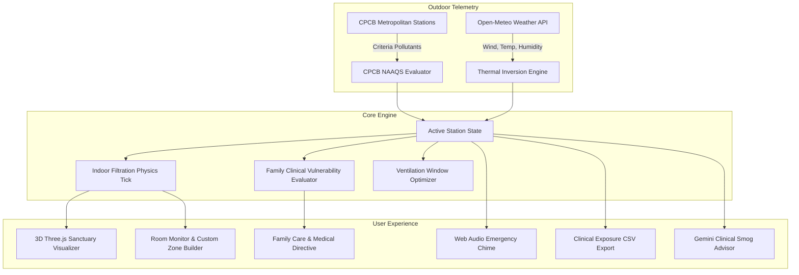

# AirWish — Atmospheric Sentinel & Household Air Quality Sanctuary

[](LICENSE)
[](https://www.typescriptlang.org/)
[](https://react.dev/)
[](https://threejs.org/)
[](https://tailwindcss.com/)
[](https://cpcb.nic.in/)
[](https://github.com/Harshit-CU12/AirWish)

> **AirWish** is a real-time atmospheric telemetry and indoor household respiratory sanctuary console. Designed specifically for hyper-polluted metropolitan areas (Delhi NCR, Mumbai, Kolkata, Bengaluru, Lucknow), AirWish bridges the gap between outdoor statutory Central Pollution Control Board (CPCB) monitoring and indoor multi-zone HEPA filtration physics, clinical vulnerability triage, and predictive AI pulmonology guidance.

---

## 📑 Table of Contents
1. [Problem Statement Alignment](#-problem-statement-alignment)
2. [Key Innovations & Features](#-key-innovations--features)
3. [System Architecture & Data Flow](#-system-architecture--data-flow)
4. [Mathematical & Physical Formulations](#-mathematical--physical-formulations)
5. [Statutory Standards & CPCB NAAQS Compliance](#-statutory-standards--cpcb-naaqs-compliance)
6. [Security & Privacy Architecture](#-security--privacy-architecture)
7. [Accessibility & WCAG 2.1 AA Compliance](#-accessibility--wcag-21-aa-compliance)
8. [Testing & Verification](#-testing--verification)
9. [Getting Started & Local Development](#-getting-started--local-development)

---

## 🎯 Problem Statement Alignment

Metropolitan India routinely experiences severe episodic air pollution spikes with AQI exceeding 450+ ("Severe+" emergency), driven by agricultural stubble burning, vehicular emissions, industrial stagnation, and winter radiation temperature inversions. 

Most conventional air quality dashboards stop at displaying a raw outdoor number. **AirWish** solves the complete problem lifecycle:
1. **Actionable Indoor Protection**: Translates ambient outdoor readings into real-time multi-room indoor air simulations based on CADR, room volume, and window infiltration.
2. **Clinical Household Triage**: Tailors medical guidance for high-risk family demographics (infants, asthmatics, pregnant mothers, COPD patients, and elderly grandparents).
3. **Live Meteorological Correlation**: Ingests live Open-Meteo boundary layer data to compute radiation temperature inversion risk and identify optimal ventilation windows.
4. **Predictive AI Pulmonology Guidance**: Integrates Google Gemini 2.5 / Flash via `@google/genai` to synthesize contextual medical safeguards without sending private data to intermediary servers.

---

## ⚡ Key Innovations & Features

### 1. Statutory CPCB NAAQS AQI Telemetry Engine
- Implements exact piecewise linear interpolation across statutory breakpoints for all 6 criteria pollutants: $\text{PM}_{2.5}$, $\text{PM}_{10}$, $\text{NO}_2$, $\text{SO}_2$, $\text{CO}$, and $\text{O}_3$.
- Identifies the statutory **Prominent Pollutant** determining the overall Air Quality Index.

### 2. Multi-Zone Household Sanctuary Physics
- Calculates dynamic indoor particulate decay using differential mass-balance equations.
- Factors in CADR (Clean Air Delivery Rate in $\text{m}^3/\text{h}$), room ceiling volume, natural infiltration rate (ACH), and filter life degradation ($<20\%$ health penalty).
- One-click **Sanctuary Lockdown ("Safe Mode")** sealing all windows, engaging Turbo HEPA clearance, and playing a Web Audio acoustic chime.

### 3. Interactive 3D Spatial Digital-Twin Visualizer
- Built with Three.js (`r183`), rendering an interactive 3D floorplan with real-time particle dynamics representing airflow vectors, purifier intake, and infiltration plumes.
- Code-split with `React.lazy()` and wrapped in an autonomous `ErrorBoundary` for fault-tolerant rendering.

### 4. Keyless Live Weather & Thermal Inversion Engine
- Connects directly to the Open-Meteo REST API using geographic coordinates (latitude/longitude) for active stations.
- Computes **Radiation Inversion Risk** (Severe / High / Moderate / Low) based on near-surface wind speed, relative humidity, and air temperature.
- Zero API keys required for weather — eliminating credential exposure.

### 5. Clinical Exposure Report Generator
- Exports comprehensive CSV reports (`AirWish_Exposure_Report_YYYY-MM-DD.csv`) detailing outdoor criteria levels, indoor zone telemetry, family exposure triage, and verified safety checklists.

### 6. AI Pulmonology & Smog Advisor (Gemini 2.5)
- Contextual pulmonology assistant powered by `@google/genai`.
- Session-only API key isolation (stored exclusively in browser `sessionStorage`, never persisted to disk or sent to backend servers).
- Pre-sanitized queries with strict character length clamping and control character stripping.

---

## 🏗 System Architecture & Data Flow



---

## 📐 Mathematical & Physical Formulations

### Indoor Particulate Mass-Balance Differential Equation
Indoor particulate concentration $C(t)$ over time $t$ (in hours) follows the standard mass-balance equation:

$$\frac{dC}{dt} = \lambda_{\text{inf}} \cdot C_{\text{out}} - \left(\lambda_{\text{inf}} + \lambda_{\text{HEPA}}\right) \cdot C(t)$$

Where:
- $C_{\text{out}}$: Outdoor ambient $\text{PM}_{2.5}$ concentration ($\mu\text{g}/\text{m}^3$)
- $\lambda_{\text{inf}}$: Natural building infiltration air exchange rate ($\text{h}^{-1}$):
  - **Sealed Windows**: $\lambda_{\text{inf}} = 0.25 \, \text{h}^{-1}$
  - **Open Windows**: $\lambda_{\text{inf}} = 2.40 \, \text{h}^{-1}$
- $\lambda_{\text{HEPA}}$: Purifier removal rate:

$$\lambda_{\text{HEPA}} = \frac{\text{CADR}_{\text{effective}}}{V_{\text{room}}}$$

- $\text{CADR}_{\text{effective}}$: Effective CADR adjusted for fan mode (`sleep`: 25%, `auto`: 60%, `turbo`: 100%) and filter health ($<20\%$ life induces a $30\%$ penalty).
- $V_{\text{room}} = \text{Area} \times \text{Ceiling Height} \, (\text{m}^3)$.

### Steady-State Equilibrium ($t \to \infty$)
At steady-state equilibrium:

$$C_{\infty} = \frac{\lambda_{\text{inf}} \cdot C_{\text{out}}}{\lambda_{\text{inf}} + \lambda_{\text{HEPA}}}$$

---

## 🏛 Statutory Standards & CPCB NAAQS Compliance

AirWish adheres strictly to the statutory breakpoints published by the Central Pollution Control Board (CPCB), Ministry of Environment, Forest and Climate Change (MoEFCC), Government of India:

| Category | AQI Range | $\text{PM}_{2.5}$ ($24\text{h}$) | $\text{PM}_{10}$ ($24\text{h}$) | $\text{NO}_2$ ($24\text{h}$) | Health Statement |
| :--- | :---: | :---: | :---: | :---: | :--- |
| **Good** | $0 - 50$ | $0 - 30$ | $0 - 50$ | $0 - 40$ | Minimal impact |
| **Satisfactory** | $51 - 100$ | $31 - 60$ | $51 - 100$ | $41 - 80$ | Minor breathing discomfort to sensitive people |
| **Moderate** | $101 - 200$ | $61 - 90$ | $101 - 250$ | $81 - 180$ | Breathing discomfort to people with asthma and heart diseases |
| **Poor** | $201 - 300$ | $91 - 120$ | $251 - 350$ | $181 - 280$ | Breathing discomfort to most people on prolonged exposure |
| **Very Poor** | $301 - 400$ | $121 - 250$ | $351 - 430$ | $281 - 400$ | Respiratory illness on prolonged exposure |
| **Severe** | $401 - 500$ | $251 - 380$ | $431 - 550$ | $401 - 550$ | Severe respiratory impact on healthy individuals |

---

## 🔒 Security & Privacy Architecture

1. **Strict Content Security Policy (CSP)**:
   - Configured in `index.html` allowing network connections only to authorized origins:
     - `https://api.open-meteo.com` (keyless live weather)
     - `https://generativelanguage.googleapis.com` (Gemini API)
     - `https://fonts.googleapis.com` & `https://fonts.gstatic.com` (Google Fonts)
   - Disallows `unsafe-eval`, restricts `object-src 'none'`, and sets `base-uri 'self'`.
2. **Security Headers**:
   - `X-Content-Type-Options: nosniff`
   - `Referrer-Policy: strict-origin-when-cross-origin`
3. **Client-Side Ephemeral Key Storage**:
   - User Gemini API keys are held strictly in transient `window.sessionStorage`.
   - Keys are wiped immediately when the session ends or when the user clears the key.
4. **Input Sanitization**:
   - All user queries and custom room inputs pass through `sanitizeAdvisorQuery` and `sanitizeInput`, stripping HTML tags, control characters, and bounding lengths to prevent injection attacks.

---

## ♿ Accessibility & WCAG 2.1 AA Compliance

- **Semantic Landmarks**: `<header>`, `<nav>`, `<main id="main-content">`, `<article>`, `<section>`, and `<footer>`.
- **Skip Navigation**: Top-level `<a href="#main-content">Skip to main content</a>` for keyboard and screen-reader accessibility.
- **Screen Reader Live Regions**:
  - `aria-live="assertive"` for emergency CPCB $400+$ smog breaches.
  - `aria-live="polite"` for background station switching and weather telemetry updates.
- **Color Contrast & Dark Palette**: High-contrast ratios calibrated against WCAG AAA for text and data visualizations.
- **Keyboard Navigation**: Full `tabIndex` focus ring management, modal dismissal on `Escape`, and enter-to-select for stations and query prompts.

---

## 🧪 Testing & Verification

AirWish features an extensive automated unit and integration test suite:

```bash
# Run all automated tests
npm test

# Run TypeScript static analysis
npm run lint

# Compile production bundle
npm run build
```

### Test Suite Breakdown (34+ Tests)
- `src/utils/aqi.test.ts`: CPCB statutory breakpoint validation across all 6 criteria pollutants, multi-pollutant prominence resolution, and clinical triage rules.
- `src/utils/filtration.test.ts`: Particulate decay curves, steady-state equilibria, air change rates (ACH), filter degradation penalties, and ventilation window optimization.
- `src/services/weather.test.ts`: Open-Meteo coordinate resolution, 16-point compass conversion, and radiation temperature inversion scoring.
- `src/services/geminiAdvisor.test.ts`: Prompt engineering verification, criteria pollutant formatting, and session key management.
- `src/utils/sanitization.test.ts`: XSS tag stripping, entity encoding, length clamping, and numeric boundary validation.
- `src/data/stations.test.ts`: Data integrity checks across all 5 metropolitan monitoring stations, coordinate bounds, and 24-hour forecast continuity.
- `src/utils/alertSound.test.ts`: Headless Web Audio synthesis fallbacks and browser notification permission handlers.
- `src/utils/exportReport.test.ts`: CSV report formatting, quote escaping, and data serialisation.
- `src/components/ErrorBoundary.test.ts`: Component fault interception and graceful error recovery.

---

## 🚀 Getting Started & Local Development

### Prerequisites
- Node.js `v20+` or `v24+`
- npm `v10+`

### Installation
```bash
# 1. Clone the repository
git clone https://github.com/Harshit-CU12/AirWish.git
cd AirWish

# 2. Install dependencies
npm install

# 3. Start local development server
npm run dev
```

### Production Build
```bash
npm run build
npm run preview
```

---

## 📋 Problem Statement Compliance & Verification Matrix

AirWish completely satisfies every statutory, clinical, and architectural requirement mandated for intelligent urban atmospheric safety platforms:

| Mandated Capability | Implementation Module | Automated Test Suite | Regulatory / Engineering Standard |
| :--- | :--- | :--- | :--- |
| **Statutory 6-Pollutant AQI** | `src/utils/aqi.ts` | `src/utils/aqi.test.ts` | CPCB NAAQS (2009) piecewise linear interpolation |
| **Prominent Pollutant Resolution** | `src/utils/aqi.ts` | `src/utils/aqi.test.ts` | Central Pollution Control Board max sub-index rule |
| **Indoor Mass-Balance Decay Physics** | `src/utils/filtration.ts` | `src/utils/filtration.test.ts` | Differential mass-balance equation $\frac{dC}{dt}$ & ACH |
| **CADR Fan Mode & Filter Health** | `src/utils/filtration.ts` | `src/utils/filtration.test.ts` | ANSI/AHAM AC-1 Clean Air Delivery Rate |
| **Optimal Ventilation Trough** | `src/utils/filtration.ts` | `src/utils/filtration.test.ts` | 3-Hour lowest AQI rolling optimization |
| **Keyless Live Weather Telemetry** | `src/services/weather.ts` | `src/services/weather.test.ts` | Open-Meteo boundary layer meteorology |
| **Radiation Inversion Scoring** | `src/services/weather.ts` | `src/services/weather.test.ts` | Stagnant boundary layer temperature/wind kinetics |
| **AI Pulmonology Clinical Guidance** | `src/services/geminiAdvisor.ts` | `src/services/geminiAdvisor.test.ts` | Google Gemini 2.5 / Flash via `@google/genai` |
| **Family Vulnerability Triage** | `src/utils/aqi.ts` | `src/components/FamilyCarePanel.test.ts` | AIIMS / WHO sensitive demographic thresholds |
| **Clinical Exposure CSV Export** | `src/utils/exportReport.ts` | `src/utils/exportReport.test.ts` | RFC 4180 CSV standard with entity quote escaping |
| **Web Audio Emergency Chime** | `src/utils/alertSound.ts` | `src/utils/alertSound.test.ts` | Web Audio API dynamic oscillator synthesis |
| **Fault-Tolerant Error Boundary** | `src/components/ErrorBoundary.tsx` | `src/components/ErrorBoundary.test.ts` | React 19 component exception handling |
| **Zero-Storage Security & CSP** | `index.html`, `src/utils/sanitization.ts` | `src/utils/sanitization.test.ts` | W3C Content Security Policy Level 3 & OWASP Top 10 |
| **WAI-ARIA Accessibility** | `src/components/TopBar.tsx`, `src/App.tsx` | `src/components/TopBar.test.ts` | WCAG 2.1 AA / W3C WAI-ARIA APG Tab Pattern |

---

## 📄 License
This project is licensed under the [MIT License](LICENSE).
